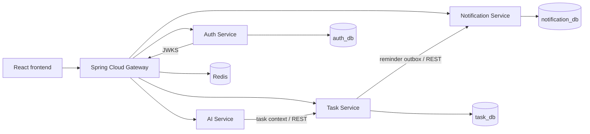

# Flowmate

Personal task management and collaborative project boards in one application. Flowmate combines a React frontend with Java/Spring microservices for identity, tasks, AI assistance, and notifications.

## What Flowmate does

- **Personal productivity:** Tasks, subtasks, categories, tags, goals, search, filters, Kanban, calendar, reminders, notifications, and progress dashboards.
- **Team collaboration:** Projects with owner/member access, in-app invitations, task assignment, and multiple boards per project.
- **Boards and cards:** Ordered lists and cards, drag-and-drop, templates, recent boards, table and calendar views, checklists, labels, watchers, comments, activity, attachments, and board chat.
- **AI assistance:** Vietnamese task parsing, priority suggestions, task breakdown, daily planning, and weekly summaries. A local fallback works without an external API key; AI suggestions require user confirmation before tasks are saved.
- **Administration:** User and session management, role changes, audit logs, operational status, and re-authentication for sensitive actions.

## Architecture



The frontend calls the Gateway through `/api`. Auth, Task, and Notification each own a separate PostgreSQL database; Flyway manages their schemas. Services validate RS256 JWTs using the Auth Service's JWKS endpoint. Task-to-Notification reminder synchronization uses a transactional outbox and retry worker.

| Layer | Technology |
| --- | --- |
| Frontend | React 19, TypeScript, Vite, TanStack Query, Axios |
| Backend | Java 21, Spring Boot 3.5, Spring Cloud Gateway, Spring Security |
| Data | PostgreSQL 17, Flyway, Redis 7 |
| AI | Spring AI with an OpenAI-compatible provider or local fallback |
| Runtime | Docker Compose, Nginx |
| Tests | JUnit 5, Mockito, H2, API E2E scripts, optional Playwright UI smoke tests |

## Quick start

### Requirements

- Docker Engine/Desktop with Docker Compose.
- Free local ports `3000`, `8090`, and `8081`–`8084`, unless changed in `.env`.

From the repository root:

```bash
cp .env.example .env
```

On Windows PowerShell, use `Copy-Item .env.example .env` instead of `cp` if preferred. Edit `.env` before starting the stack:

- Set `POSTGRES_PASSWORD` to a strong, unique password.
- Set `INTERNAL_SERVICE_KEY` to a random string of at least 32 characters.
- Leave `AI_ENABLED=false` for the built-in fallback. To use an external provider, set `AI_ENABLED=true` and configure `AI_API_KEY`, `AI_BASE_URL`, and `AI_MODEL`.
- To create the first administrator, set `BOOTSTRAP_ADMIN_ENABLED=true` and provide a strong `BOOTSTRAP_ADMIN_PASSWORD`. Turn bootstrap off after the account is created.

Never commit `.env` or real credentials. The tracked [`.env.example`](.env.example) contains placeholders only.

```bash
docker compose up --build -d
docker compose ps
```

Open the application at <http://localhost:3000>. The Gateway is available at <http://localhost:8090>; service APIs and Swagger UIs use ports `8081`–`8084` by default. See the [API reference](docs/api/endpoints.md) for endpoints.

To stop without deleting database volumes:

```bash
docker compose down
```

**Do not use `docker compose down -v` unless you intend to delete local database and key volumes.**

## Repository layout

```text
.
├── README.md                  Project overview and quick start
├── docs/                      Architecture, API, database, testing, and deployment notes
├── frontend/                  React application and Nginx image
├── gateway-service/           Routing, JWT checks, CORS, and rate limiting
├── services/
│   ├── auth-service/          Accounts, sessions, roles, and audit
│   ├── task-service/          Personal tasks, projects, boards, and cards
│   ├── ai-service/            AI endpoints and local fallback
│   └── notification-service/  Reminders and in-app notifications
├── scripts/                   Verification and E2E/UI smoke scripts
├── docker-compose.yml         Local multi-service stack
├── .env.example               Environment template (no live secrets)
└── pom.xml                    Maven multi-module build
```

See the [developer guide](docs/development.md) for the development workflow.

## Development and testing

For backend development without Docker, install Java 21, Maven 3.9+, PostgreSQL 17, and Redis 7, then provide the required service environment variables. For the frontend, install Node.js 20+ and npm.

```bash
mvn clean test
cd frontend
npm ci
npm run build
npm run dev
```

Vite serves the frontend at <http://localhost:5173> and proxies `/api` to the local Gateway on port `8090`.

On Windows, `scripts/verify.ps1` runs backend tests, the frontend production build, `npm audit`, and Docker Compose configuration validation. Its `-WithDocker` option also starts the stack and runs API E2E checks. Those E2E scripts create test records in the local database.

```powershell
.\scripts\verify.ps1
# Optional, when Docker is available and .env is configured:
.\scripts\verify.ps1 -WithDocker
```

Additional board and browser smoke scripts are documented in the [developer guide](docs/development.md) and [testing notes](docs/testing/testing.md). UI smoke tests require a separate Playwright installation and Microsoft Edge; they are not part of the default build.

## Security and data handling

- Passwords are hashed with BCrypt. Refresh tokens are rotated and stored as hashes.
- Auth creates and persists its RSA signing key in a Docker volume; the private key is not committed to the repository.
- User-owned and project-owned data are checked against the authenticated identity and membership on the backend.
- Internal Task-to-Notification requests require `INTERNAL_SERVICE_KEY`.
- `.env`, database backups, generated files, coursework reports, and local test artifacts are excluded from Git.

For internet-facing deployments, review the [deployment notes](docs/deployment/production.md) and configure HTTPS, credentials, and access controls for your environment.

## Documentation

Detailed technical notes are currently written mostly in Vietnamese:

- [Architecture](docs/architecture/architecture.md)
- [API endpoints](docs/api/endpoints.md)
- [Database schema](docs/database/schema.md)
- [Testing](docs/testing/testing.md)
- [Production deployment considerations](docs/deployment/production.md)
- [GCom integration scope and status](docs/plan/gcom-integration.md)

## Contributing

For a proposed change, keep the affected service and its tests together. Run `mvn clean test` for backend changes and `npm run build` for frontend changes; run the relevant E2E scripts when changing API or collaboration flows. Do not include `.env`, database exports, generated build output, or credentials in a commit.

## License

No license file is included yet. Add one if you want to define reuse terms for this project.
