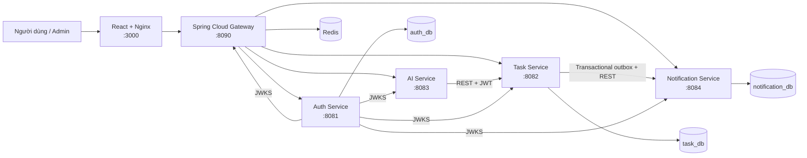

# Flowmate

**Nền tảng quản lý công việc cá nhân và dự án nhóm tích hợp AI, xây dựng theo kiến trúc microservices.**

Flowmate hỗ trợ người dùng tổ chức công việc, checklist, danh mục, nhãn và mục tiêu cá nhân trên một giao diện thống nhất. Hệ thống cung cấp Kanban, lịch, nhắc việc, thông báo trong ứng dụng, thống kê tiến độ và trợ lý AI tiếng Việt. Ngoài phần cá nhân, người dùng có thể tạo dự án nhóm, mời thành viên theo email tài khoản và giao công việc trong dự án.

## Mục lục

- [Tính năng chính](#tính-năng-chính)
- [Kiến trúc hệ thống](#kiến-trúc-hệ-thống)
- [Công nghệ sử dụng](#công-nghệ-sử-dụng)
- [Cấu trúc repository](#cấu-trúc-repository)
- [Yêu cầu môi trường](#yêu-cầu-môi-trường)
- [Khởi chạy bằng Docker Compose](#khởi-chạy-bằng-docker-compose)
- [Chạy ở chế độ phát triển](#chạy-ở-chế-độ-phát-triển)
- [Kiểm thử](#kiểm-thử)
- [Bảo mật và dữ liệu](#bảo-mật-và-dữ-liệu)
- [Tài liệu kỹ thuật](#tài-liệu-kỹ-thuật)
- [Giới hạn hiện tại](#giới-hạn-hiện-tại)

## Tính năng chính

### Người dùng

- Đăng ký, đăng nhập, làm mới phiên, đăng xuất và đổi mật khẩu.
- Quản lý hồ sơ, múi giờ, giờ làm việc, giao diện và thời gian nhắc mặc định.
- Tạo, xem, sửa, xóa mềm và tìm kiếm công việc.
- Lọc công việc theo trạng thái, độ ưu tiên, danh mục, nhãn và thời hạn.
- Các chế độ xem Today, Upcoming, Overdue, Kanban và lịch tháng.
- Quản lý checklist, danh mục, nhãn và mục tiêu cá nhân.
- Theo dõi dashboard và tỷ lệ hoàn thành trong tuần.
- Tạo reminder theo deadline và nhận thông báo trong ứng dụng.

### Dự án nhóm

- Tạo và cập nhật dự án; chủ dự án có thể lưu trữ hoặc mở lại dự án.
- Mời thành viên bằng email tài khoản; lời mời xuất hiện trong ứng dụng và hết hạn sau 7 ngày.
- Vai trò `OWNER`/`MEMBER` theo từng dự án, độc lập với vai trò quản trị hệ thống `ADMIN`.
- Tạo, giao, cập nhật và theo dõi tiến độ công việc nhóm; chỉ thành viên dự án được xem dữ liệu.
- Công việc cá nhân và công việc nhóm được lưu riêng trong Task Service. AI, reminder và dashboard cá nhân hiện chưa xử lý công việc nhóm.

Để thử: đăng ký hai tài khoản A và B; A tạo dự án tại **Dự án nhóm** và mời email của B; B đăng nhập để chấp nhận lời mời; A giao việc cho B, sau đó B cập nhật trạng thái. Lời mời hiện được hiển thị trong ứng dụng, chưa gửi thư ra hộp thư.

### Trợ lý AI

- Phân tích câu lệnh tiếng Việt thành bản nháp công việc.
- Đề xuất độ ưu tiên và chia nhỏ công việc thành checklist.
- Lập kế hoạch trong ngày và tóm tắt tiến độ tuần.
- Hoạt động với AI provider tương thích OpenAI khi được cấu hình.
- Tự động dùng bộ phân tích cục bộ khi AI bị tắt hoặc provider không khả dụng.
- Chỉ tạo bản xem trước; người dùng phải xác nhận trước khi dữ liệu được ghi vào Task Service.

### Quản trị

- Dashboard tổng quan và trạng thái vận hành của các service.
- Tìm kiếm, lọc, khóa hoặc mở khóa tài khoản.
- Cấp và thu hồi vai trò `ADMIN`.
- Xem và thu hồi phiên đăng nhập.
- Theo dõi nhật ký kiểm toán.
- Yêu cầu xác thực lại đối với thao tác nhạy cảm.
- Không cung cấp API cho Admin đọc nội dung công việc cá nhân của người dùng.

## Kiến trúc hệ thống



Frontend chỉ gọi API qua Gateway. Mỗi service sở hữu dữ liệu của chính mình và không truy cập trực tiếp database của service khác.

| Thành phần | Trách nhiệm | Dữ liệu sở hữu |
|---|---|---|
| Frontend | Giao diện người dùng và quản trị | Không có database |
| API Gateway | Routing, CORS, JWT ở biên và rate limiting bằng Redis | Không có database |
| Auth Service | Tài khoản, hồ sơ, cài đặt, phiên, vai trò và audit log | `auth_db` |
| Task Service | Task cá nhân, dự án nhóm, thành viên, lời mời, giao việc và thống kê | `task_db` |
| AI Service | Phân tích và đề xuất; không trực tiếp ghi task | Không có database |
| Notification Service | Reminder scheduler và thông báo trong ứng dụng | `notification_db` |

Task Service ghi task và lệnh đồng bộ reminder trong cùng một transaction. Worker gửi lệnh sang Notification Service và tự retry với exponential backoff khi service đích tạm thời không khả dụng.

## Công nghệ sử dụng

| Nhóm | Công nghệ |
|---|---|
| Backend | Java 21, Spring Boot 3.5, Spring Cloud Gateway, Spring Security, Spring Data JPA |
| Frontend | React 19, TypeScript, Vite, TanStack Query, Axios, Recharts, dnd-kit |
| Database | PostgreSQL 17, Flyway |
| Cache / rate limit | Redis 7 |
| Xác thực | JWT RS256, OAuth2 Resource Server, JWKS, BCrypt |
| AI | Spring AI và API tương thích OpenAI; local fallback parser |
| Tài liệu API | Springdoc OpenAPI / Swagger UI |
| Hạ tầng | Docker, Docker Compose, Nginx |
| Kiểm thử | JUnit 5, Mockito, H2, Node.js E2E, Playwright UI smoke |

## Cấu trúc repository

```text
.
├── source-code/
│   ├── frontend/                 React + TypeScript + Vite
│   ├── gateway-service/          Spring Cloud Gateway
│   ├── services/
│   │   ├── auth-service/         Xác thực, người dùng và quản trị
│   │   ├── task-service/         Công việc cá nhân và dự án nhóm
│   │   ├── ai-service/           Trợ lý AI
│   │   └── notification-service/ Reminder và thông báo
│   ├── scripts/                  Verify, E2E và UI smoke
│   ├── docker-compose.yml        Toàn bộ local stack
│   ├── .env.example              Cấu hình môi trường mẫu
│   └── pom.xml                   Maven multi-module reactor
├── docs/
│   ├── architecture/             Kiến trúc và luồng hệ thống
│   ├── api/                      Danh sách endpoint
│   ├── database/                 Lược đồ dữ liệu
│   ├── deployment/               Hướng dẫn triển khai
│   ├── testing/                  Chiến lược kiểm thử
│   └── plan/                     Kế hoạch thực hiện
└── README.md                     Hướng dẫn tổng quan
```

Báo cáo Word, sơ đồ, bản sao lưu và kết quả kiểm thử được giữ cục bộ nhưng không đưa lên Git.

## Yêu cầu môi trường

### Cách chạy khuyến nghị

- Docker Desktop có Docker Compose.

### Chạy thủ công

- Java 21.
- Maven 3.9 trở lên.
- Node.js 20 trở lên và npm.
- PostgreSQL 17.
- Redis 7 nếu chạy Gateway với rate limiting.

## Khởi chạy bằng Docker Compose

### 1. Vào thư mục mã nguồn

```powershell
Set-Location source-code
```

Trên macOS hoặc Linux:

```bash
cd source-code
```

### 2. Tạo file cấu hình môi trường

Windows PowerShell:

```powershell
Copy-Item .env.example .env
```

Command Prompt:

```cmd
copy .env.example .env
```

macOS hoặc Linux:

```bash
cp .env.example .env
```

Thay toàn bộ giá trị mẫu không an toàn trong `.env`, đặc biệt:

```dotenv
POSTGRES_PASSWORD=<mat-khau-database-manh>
INTERNAL_SERVICE_KEY=<chuoi-ngau-nhien-toi-thieu-32-ky-tu>
```

Không commit `.env` hoặc API key thật vào repository.

### 3. Cấu hình AI

Flowmate chạy được mà không cần API key:

```dotenv
AI_ENABLED=false
```

Để sử dụng AI provider tương thích OpenAI:

```dotenv
AI_ENABLED=true
AI_API_KEY=<api-key>
AI_BASE_URL=https://api.openai.com
AI_MODEL=<model>
```

Trên Windows có thể dùng script sau sau khi cập nhật `.env`:

```powershell
.\scripts\enable-ai.ps1
```

### 4. Tạo Admin đầu tiên nếu cần

Cập nhật tạm thời các biến sau:

```dotenv
BOOTSTRAP_ADMIN_ENABLED=true
BOOTSTRAP_ADMIN_EMAIL=admin@flowmate.local
BOOTSTRAP_ADMIN_PASSWORD=<mat-khau-admin-manh>
BOOTSTRAP_ADMIN_NAME=Flowmate Administrator
```

Sau lần khởi động đầu tiên và khi Admin đã được tạo, đặt lại:

```dotenv
BOOTSTRAP_ADMIN_ENABLED=false
```

### 5. Build và khởi động

```bash
docker compose up --build -d
docker compose ps
```

Xem log khi cần:

```bash
docker compose logs -f gateway-service
docker compose logs -f task-service
```

### 6. Truy cập hệ thống

| Thành phần | Địa chỉ |
|---|---|
| Website | <http://localhost:3000> |
| Trang quản trị | <http://localhost:3000/admin> |
| API Gateway | <http://localhost:8090> |
| Auth Swagger | <http://localhost:8081/swagger-ui/index.html> |
| Task Swagger | <http://localhost:8082/swagger-ui/index.html> |
| AI Swagger | <http://localhost:8083/swagger-ui/index.html> |
| Notification Swagger | <http://localhost:8084/swagger-ui/index.html> |

Các port có thể được thay đổi trong `.env`.

### 7. Dừng hệ thống

```bash
docker compose down
```

Lệnh trên giữ lại dữ liệu trong Docker volume. Chỉ dùng lệnh sau khi chủ động muốn xóa toàn bộ dữ liệu local:

```bash
docker compose down -v
```

## Chạy ở chế độ phát triển

### Backend

Từ thư mục `source-code/`:

```bash
mvn clean test
mvn -pl services/auth-service spring-boot:run
```

Thay module trong lệnh thứ hai để chạy service khác. Khi chạy thủ công, cần chuẩn bị database, Redis và các biến môi trường tương ứng.

### Frontend

```bash
cd source-code/frontend
npm install
npm run dev
```

Vite chạy mặc định tại <http://localhost:5173> và proxy `/api` đến Gateway tại <http://localhost:8090>.

## Kiểm thử

### Kiểm tra nhanh trên Windows

```powershell
Set-Location source-code
.\scripts\verify.ps1
```

Script tự tìm JDK 21, chạy test backend, build frontend và kiểm tra cấu hình Docker Compose.

Để dựng container và chạy E2E:

```powershell
.\scripts\verify.ps1 -WithDocker
```

### Chạy từng tầng kiểm thử

Backend:

```bash
cd source-code
mvn clean test
```

Frontend:

```bash
cd source-code/frontend
npm install
npm run build
```

E2E qua Gateway khi Docker Compose đang chạy:

```powershell
$env:ADMIN_EMAIL="admin@flowmate.local"
$env:ADMIN_PASSWORD="<mat-khau-admin-trong-env>"
node scripts/e2e.mjs
```

UI smoke trên Microsoft Edge:

```powershell
$env:CODEX_NODE_MODULES="<thu-muc-node_modules-co-playwright>"
node scripts/ui-smoke.mjs
```

Chi tiết xem tại [docs/testing/testing.md](docs/testing/testing.md).

## Bảo mật và dữ liệu

- Mật khẩu được băm bằng BCrypt.
- Access token dùng JWT RS256; public key được phân phối qua JWKS.
- RSA private key được lưu trong Docker volume, không nằm trong source code.
- Refresh token được xoay vòng và chỉ lưu bản băm SHA-256 trong database.
- Thay đổi mật khẩu, khóa tài khoản hoặc đổi vai trò sẽ thu hồi refresh token đang hoạt động.
- Endpoint quản trị được kiểm tra `ROLE_ADMIN` tại Gateway và service đích.
- Thao tác quản trị nhạy cảm yêu cầu action token sau khi Admin xác thực lại mật khẩu.
- Dữ liệu nghiệp vụ được giới hạn theo `userId` lấy từ JWT, không tin `userId` do frontend gửi.
- Gateway áp dụng rate limiting; AI Service có thêm quota theo phút, ngày và giới hạn số request đồng thời.
- Giao tiếp nội bộ Task–Notification sử dụng `INTERNAL_SERVICE_KEY` tối thiểu 32 ký tự.

> Refresh token trên trình duyệt hiện được lưu trong `localStorage`. Khi triển khai Internet công khai, nên chuyển sang Secure HttpOnly Cookie và bắt buộc HTTPS.

## Tài liệu kỹ thuật

- [Kiến trúc và luồng hệ thống](docs/architecture/architecture.md)
- [Danh sách API](docs/api/endpoints.md)
- [Lược đồ database](docs/database/schema.md)
- [Chiến lược kiểm thử](docs/testing/testing.md)
- [Đối chiếu chức năng với Vikunja và lộ trình bổ sung](docs/plan/vikunja-gap-analysis.md)
- [Test case dự án nhóm](docs/testing/team-project-cases.md)
- [Triển khai môi trường thực tế](docs/deployment/production.md)
- [Kế hoạch thực hiện 5 tuần](docs/plan/5-week-plan.md)
- [Kế hoạch chức năng Admin](docs/plan/admin-plan.md)
- [README dành cho mã nguồn](source-code/README.md)

## Giới hạn hiện tại

- Lời mời theo email chỉ hiển thị trong ứng dụng; chưa gửi thư ra hộp thư và chưa xác minh email tài khoản.
- Công việc nhóm chưa có checklist, nhắc việc, AI hoặc đồng bộ vào dashboard cá nhân.
- Chưa có email hoặc push notification; hệ thống hiện dùng thông báo trong ứng dụng.
- Chưa triển khai đầy đủ scheduler cho công việc lặp.
- Chưa có attachment và object storage.
- Chưa có tracing và observability tập trung cho nhiều instance.
- AI thật cần API key do người triển khai cung cấp; source code không chứa khóa mặc định.

## Phạm vi sử dụng

Flowmate được xây dựng phục vụ mục đích học tập và trình bày đồ án. Trước khi triển khai production, cần thay toàn bộ secret mặc định, bật HTTPS, chuyển refresh token sang Secure HttpOnly Cookie, giới hạn CORS theo domain thực tế và bổ sung hệ thống giám sát tập trung.
