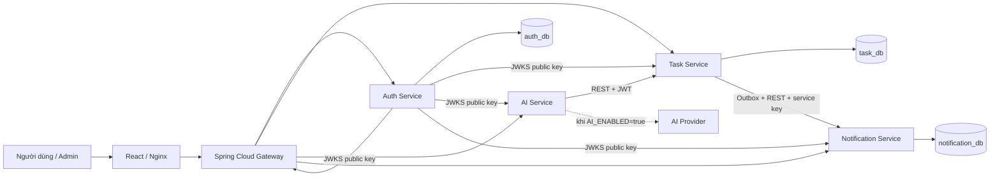
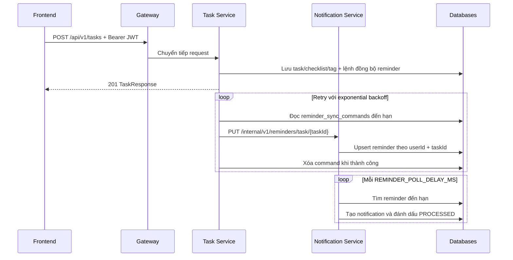

# Kiến trúc hệ thống

## Quyết định phạm vi

Hệ thống giữ công việc cá nhân và bổ sung dự án nhóm. Dự án, thành viên, lời mời và công việc nhóm nằm trong Task Service; chưa cần Project Service riêng. `Goal`, `Category` và `Tag` vẫn thuộc dữ liệu cá nhân. Công việc nhóm lưu trong bảng riêng để các API cá nhân không vô tình trả dữ liệu nhóm.

## Sơ đồ thành phần

## Trách nhiệm

| Thành phần | Trách nhiệm | Dữ liệu sở hữu |
|---|---|---|
| Gateway | Route, CORS, xác thực JWT ở biên, tổng hợp health quản trị | Không có database |
| Auth Service | Tài khoản, vai trò/trạng thái, hồ sơ, settings, phiên, action token và audit | User, UserSettings, RefreshToken, AdminActionToken, AdminAuditLog |
| Task Service | Task cá nhân, dự án nhóm, thành viên, lời mời, giao việc và thống kê | Task, Subtask, Category, Tag, Goal, TeamProject, TeamProjectMember, TeamProjectInvitation, TeamProjectTask |
| AI Service | Phân tích, đề xuất và trạng thái cấu hình đã khử bí mật; không ghi task | Không có database |
| Notification Service | Reminder scheduler, in-app notification và số liệu tổng hợp Admin | Reminder, Notification |

Không tách `Admin Service`: quản trị tài khoản/audit thuộc Auth Service; thống kê đặt tại service sở hữu dữ liệu; Gateway chỉ tổng hợp health. Cách này giữ đúng ranh giới dữ liệu và tránh một service quản trị truy cập trực tiếp database của service khác.

## Luồng tạo task có reminder

Task và lệnh đồng bộ reminder được ghi trong cùng transaction. Nếu Notification Service tạm thời không khả dụng, command được giữ trong `task_db` và thử lại với exponential backoff tối đa 5 phút. Endpoint nội bộ yêu cầu `INTERNAL_SERVICE_KEY` tối thiểu 32 ký tự, không sử dụng access token của người dùng đã có thể hết hạn.

## Bảo mật

- Auth ký RS256; các service xác thực bằng JWKS.
- RSA private key nằm trong volume `auth-key-data`, không nằm trong repository.
- Access token 15 phút; refresh token 30 ngày và được rotate mỗi lần dùng.
- Security stateless, CSRF tắt cho REST API, Swagger/health là public.
- Ownership được kiểm tra trong repository/service bằng subject UUID của JWT.
- API dự án nhóm lấy UUID/email từ JWT; chỉ thành viên được đọc, OWNER quản lý dự án và thành viên, người tạo hoặc người được giao được cập nhật task theo quyền của mình.
- JWT mang `roles` và `permissions`; mọi endpoint `/api/v1/admin/**` kiểm tra `ROLE_ADMIN` tại Gateway và service đích.
- Khóa tài khoản/đổi vai trò thu hồi toàn bộ refresh token. Access token hiện tại có thể còn hiệu lực tối đa 15 phút, là cửa sổ nhất quán đã được giới hạn của kiến trúc stateless.
- Đổi trạng thái, đổi vai trò và thu hồi phiên yêu cầu action token sau khi Admin nhập lại mật khẩu. Token được lưu dạng hash, hết hạn sau 5 phút.
- Audit log là append-only ở tầng ứng dụng và ghi cả người thực hiện, đối tượng, hành động, lý do, IP, user-agent, thời gian.
- Admin không có API đọc nội dung task của người dùng; chỉ có thống kê toàn cục.
- Lời mời nhóm gắn với email trong JWT và hiển thị trong ứng dụng. Trước khi triển khai công khai cần bổ sung xác minh email để tránh tài khoản dùng email chưa được chứng minh quyền sở hữu.

## Khả năng mở rộng sau MVP

- Message broker có thể thay thế worker REST khi cần mở rộng nhiều instance.
- Recurrence scheduler đầy đủ, email/push notification.
- Rate limiting tại Gateway và distributed tracing.
- Object storage cho attachment.
- AI provider abstraction và quota theo người dùng.
