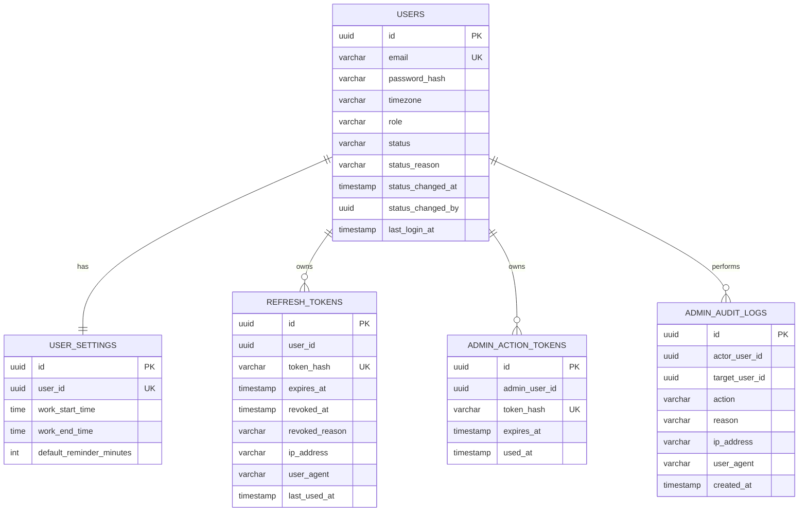
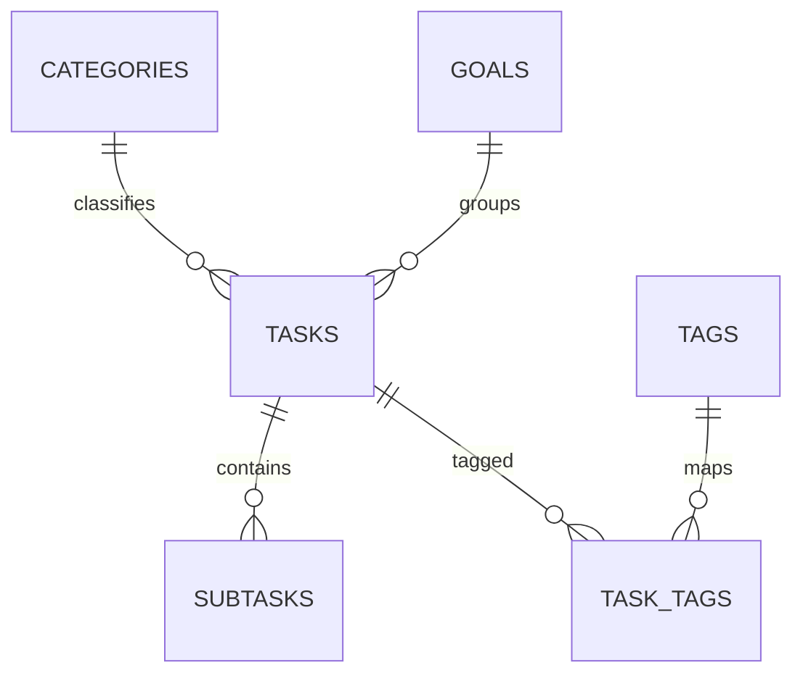

# Database và migration

Mỗi service sở hữu database riêng; không có foreign key xuyên database. Hibernate dùng `ddl-auto=validate`, còn Flyway là nguồn sự thật của schema.

## auth_db

`users.role` chỉ nhận `USER/ADMIN`; `users.status` nhận `ACTIVE/LOCKED/SUSPENDED/DEACTIVATED`. Giao diện quản trị hiện cho phép chuyển `ACTIVE/SUSPENDED`; các trạng thái còn lại được dành cho chính sách khóa tự động hoặc đóng tài khoản sau này.

## task_db

Task dùng `Instant` cho thời điểm, UUID cho ID, enum dạng chuỗi cho status/priority, `@Version` cho optimistic locking và `deleted_at` cho xóa mềm.
`tasks.reminder_minutes_before` lưu cấu hình nhắc của task. `reminder_sync_commands` là transactional outbox theo `task_id`; command UPSERT/DELETE được retry cho đến khi Notification Service xác nhận thành công.

Nhóm dự án sử dụng `team_projects`, `team_project_members`, `team_project_invitations` và `team_project_tasks` trong cùng `task_db`. Lời mời gắn với email tài khoản và hết hạn sau 7 ngày; assignee của task nhóm phải là thành viên dự án. Task nhóm có `version` để phát hiện cập nhật đồng thời và `deleted_at` để xóa mềm. Bốn bảng này không thay đổi bảng `tasks` cá nhân.

## notification_db

`reminders` lưu lịch và trạng thái PENDING/PROCESSING/PROCESSED. `notifications` lưu thông báo trong ứng dụng và thời điểm đọc. Cặp task/user được Notification Service quản lý qua REST, không có FK tới task_db.

Migration hiện tại:

- `services/auth-service/src/main/resources/db/migration/V1__create_auth_tables.sql`
- `services/auth-service/src/main/resources/db/migration/V2__add_admin_security.sql`
- `services/task-service/src/main/resources/db/migration/V1__create_task_tables.sql`
- `services/task-service/src/main/resources/db/migration/V2__add_reminder_sync_outbox.sql`
- `services/task-service/src/main/resources/db/migration/V3__add_team_projects.sql`
- `services/notification-service/src/main/resources/db/migration/V1__create_notification_tables.sql`
